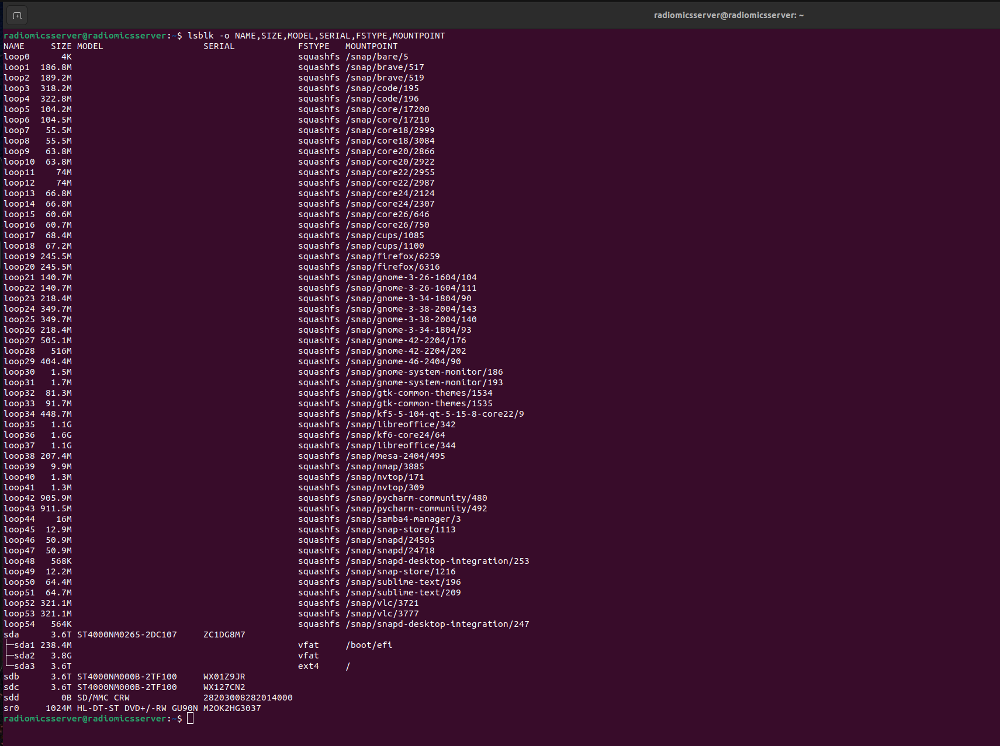
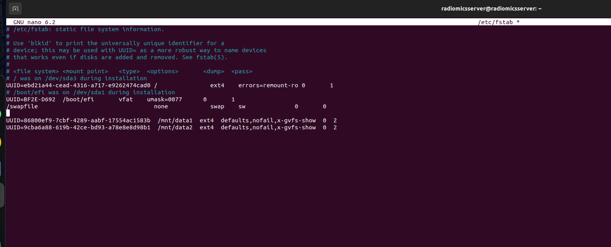
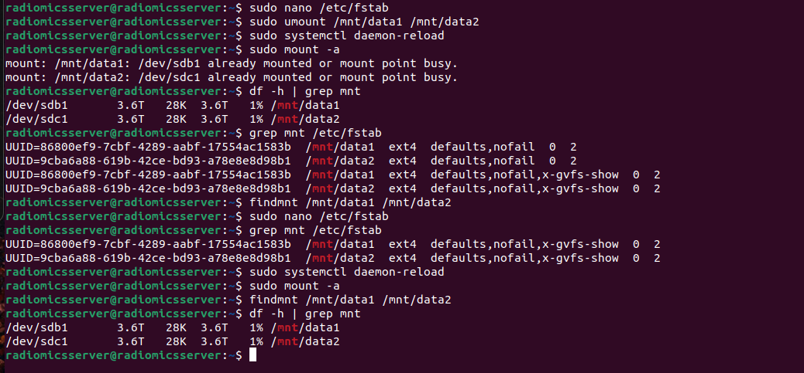

# Installing New Hard Drives on a Dell Precision 5820 (Ubuntu 22.04)

A practical, step-by-step guide to installing and configuring new internal hard drives on an Ubuntu workstation or server **without touching the existing system drive or its data**. It was written from a real installation of two 4 TB SATA drives in a Dell Precision 5820 Tower running Ubuntu 22.04 LTS.

## About

When you add a brand-new drive to a Linux machine, the operating system detects it but cannot store files on it until it has been **partitioned**, **formatted** and **mounted**. This repository documents that whole process end to end:

- how to identify the new drives safely (so you never format the wrong one),
- how to partition them (GPT), format them (ext4) and mount them,
- how to make the mounts permanent with `/etc/fstab` using UUIDs,
- how to give your user write access,
- how to verify the result and troubleshoot common problems,
- an optional RAID 1 (mirror) alternative,
- and an optional, safety-checked helper script that automates the same steps.

It is aimed at researchers, students, lab engineers and anyone running a shared compute or data server who needs more storage and wants to avoid risking existing data.

## Example environment

| Item | Value |
|---|---|
| Machine | Dell Precision 5820 Tower |
| CPU / RAM | Intel Xeon W-2265, 64 GB |
| OS | Ubuntu 22.04.5 LTS, GNOME, X11 |
| Existing drive | 1 x 4 TB (system + data), shown as `sda` |
| New drives | 2 x 4 TB Seagate SATA, shown as `sdb` and `sdc` |
| Result | `/mnt/data1` and `/mnt/data2`, about 3.6 TB each, mounted automatically at boot |

The same steps work on any Ubuntu or Debian-based system. Only the device names change.

## Contents

| File | Description |
|---|---|
| [`docs/01-step-by-step-guide.md`](docs/01-step-by-step-guide.md) | The full installation procedure, with commands and expected output |
| [`docs/02-concepts-explained.md`](docs/02-concepts-explained.md) | Plain-language explanation of partitions, formatting, mounting, fstab and UUIDs |
| [`docs/03-safety-checklist.md`](docs/03-safety-checklist.md) | How to avoid touching the existing drive, plus backup advice |
| [`docs/04-troubleshooting.md`](docs/04-troubleshooting.md) | Problems that came up in practice and how they were fixed |
| [`docs/05-optional-raid1.md`](docs/05-optional-raid1.md) | Mirroring the two new drives with `mdadm` instead of using them separately |
| [`docs/06-using-the-new-storage.md`](docs/06-using-the-new-storage.md) | Moving data, Docker storage, and why the system drive does not overflow automatically |
| [`docs/images/`](docs/images/) | Screenshots from the real installation, used throughout the docs |
| [`scripts/setup_drives.sh`](scripts/setup_drives.sh) | Optional automated version of the guide, with safety checks |
| [`LICENSE`](LICENSE) | MIT License |

## Quick start (summary)

> Read the [full guide](docs/01-step-by-step-guide.md) and the [safety checklist](docs/03-safety-checklist.md) first. These commands **erase** the drives you name.

```bash
# 1. Identify the new, empty drives (no FSTYPE, no MOUNTPOINT, correct serial)
lsblk -o NAME,SIZE,MODEL,SERIAL,FSTYPE,MOUNTPOINT

# 2. Partition (GPT, one partition)
sudo parted /dev/sdX --script mklabel gpt mkpart primary ext4 0% 100%

# 3. Format as ext4
sudo mkfs.ext4 -m 0 -L data1 /dev/sdX1

# 4. Mount
sudo mkdir -p /mnt/data1
sudo mount /dev/sdX1 /mnt/data1

# 5. Make it permanent: add the UUID (from `sudo blkid`) to /etc/fstab
#    UUID=<uuid>  /mnt/data1  ext4  defaults,nofail  0  2

# 6. Test and set ownership
sudo mount -a
sudo chown -R $USER:$USER /mnt/data1
```

Replace `sdX` with your new drive. Double-check it before every destructive command.

## Screenshots

Screenshots from the real installation are embedded in the guide at the step they belong to. A few highlights:

**1. Identify the drives with `lsblk`.** The system drive `sda` has partitions and mount points; the new drives `sdb` and `sdc` are empty.



**2. Add the new drives to `/etc/fstab`** so they mount automatically at every boot.



**3. Verify.** One fstab line per drive, `mount -a` with no errors, and both drives listed at 3.6T.



All screenshots are in [`docs/images/`](docs/images/).

## Important notes

- **Formatting erases data.** Always confirm the target drive's serial number and that it has no filesystem and no mount point before you format it.
- **Device names can change.** `sdb` today may be `sdc` after a reboot or hardware change. Use UUIDs in `/etc/fstab`.
- **RAID is not a backup.** Keep important data copied in more than one place.
- These instructions are provided as-is, without warranty. Test on non-critical data first and keep a backup of anything you cannot afford to lose.

## Contributing

Corrections, clearer wording and additional distribution notes are welcome. Open an issue or a pull request.

## License

Released under the [MIT License](LICENSE).
