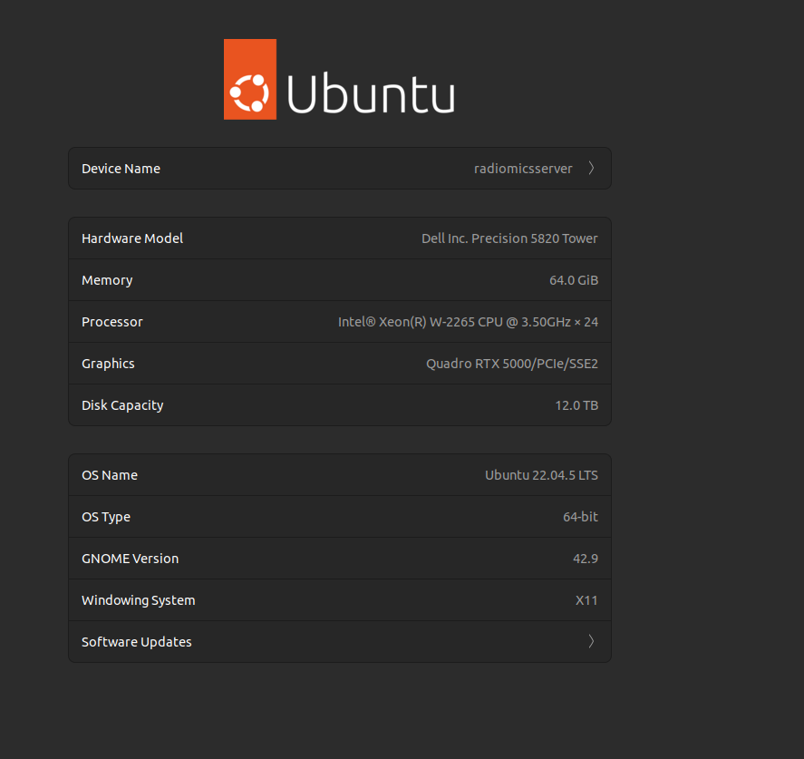
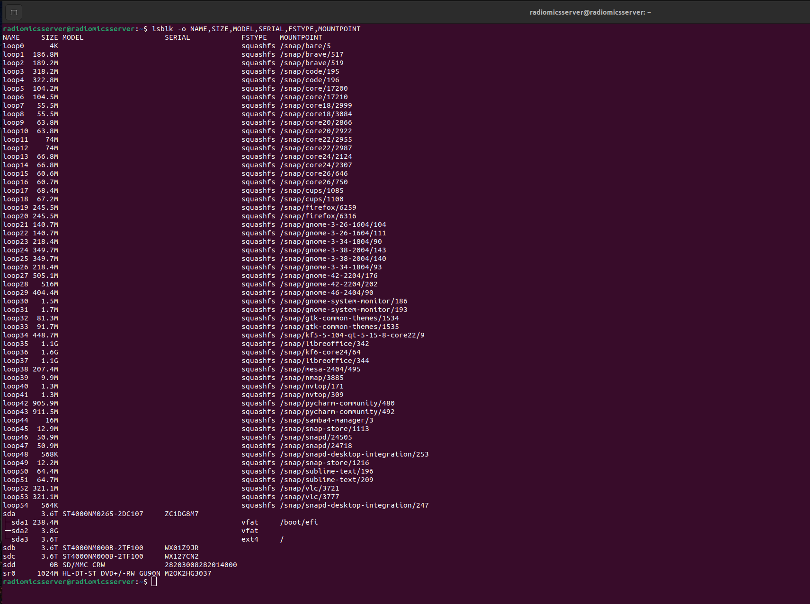
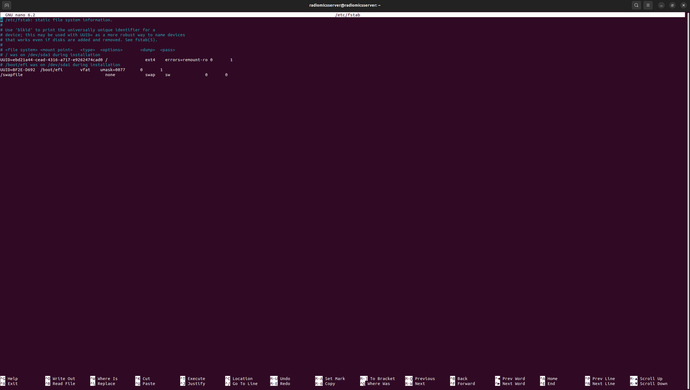
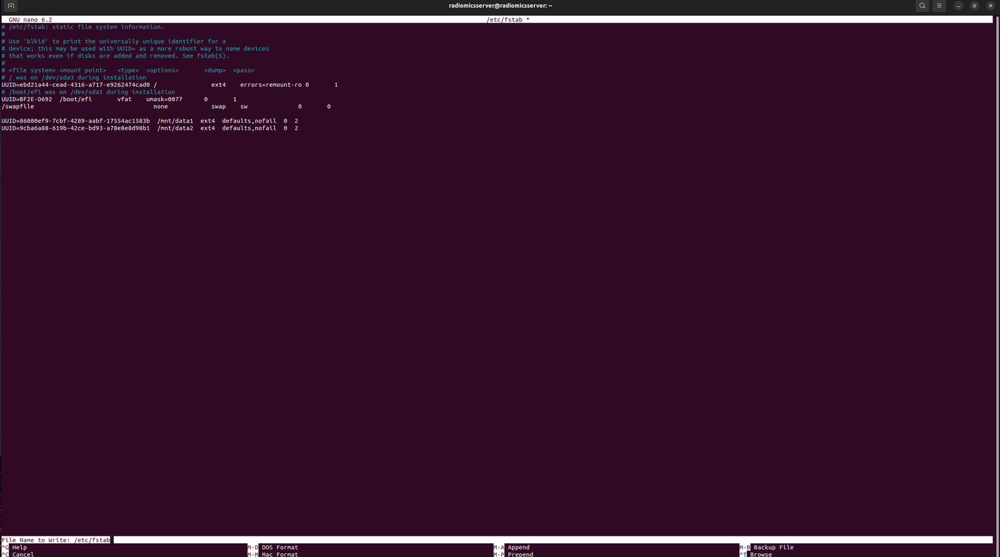
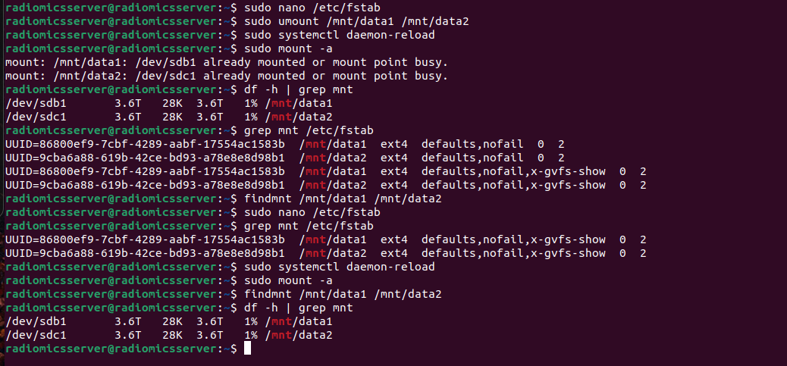
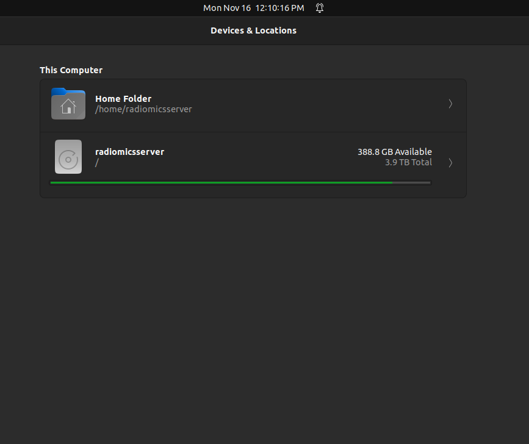

# Step-by-Step Guide: Installing New Hard Drives on Ubuntu

This guide assumes the drives are **already physically installed** and connected (SATA data + power) and that Ubuntu can see them. It leaves the existing system drive untouched.

> **Warning:** Steps 3 to 5 erase the drives you name. Complete the [safety checklist](03-safety-checklist.md) first.

Throughout the guide, `sdb` and `sdc` are the new drives and `sda` is the existing system drive. Your letters may differ.

The example machine, as shown in **Settings > About**: a Dell Precision 5820 Tower with 64 GB RAM, an Intel Xeon W-2265 CPU and Ubuntu 22.04.5 LTS. The "Disk Capacity" of 12.0 TB is the total of the existing 4 TB drive plus the two new 4 TB drives.



---

## Step 1. Identify the drives

```bash
lsblk -o NAME,SIZE,MODEL,SERIAL,FSTYPE,MOUNTPOINT
```

Example (loop devices omitted):

```
NAME   SIZE MODEL              SERIAL     FSTYPE MOUNTPOINT
sda    3.6T ST4000NM0265-2DC107  <serial>
├─sda1 238M                               vfat   /boot/efi
├─sda2 3.8G                               vfat
└─sda3 3.6T                               ext4   /
sdb    3.6T ST4000NM000B-2TF100  <serial>
sdc    3.6T ST4000NM000B-2TF100  <serial>
```

Screenshot from the real installation (the long list of `loop` entries at the top are Snap package images and can be ignored):



How to read it:

- `sda` has partitions and is mounted at `/` and `/boot/efi`. **This is the system drive. Do not touch it.**
- `sdb` and `sdc` have no partitions, no filesystem and no mount point. These are the new, empty drives.
- Match the serial numbers printed on the drive labels (or in the BIOS or purchase paperwork) to the `SERIAL` column to be certain.

Optionally confirm the drives are healthy:

```bash
sudo apt install -y smartmontools
sudo smartctl -H /dev/sdb
sudo smartctl -H /dev/sdc
```

Both should report `PASSED`.

## Step 2. Re-confirm the targets

Just before you erase anything, run it again for the exact devices you intend to use:

```bash
lsblk -o NAME,SIZE,SERIAL,FSTYPE,MOUNTPOINT /dev/sdb /dev/sdc
```

Proceed only if the serials match, and FSTYPE and MOUNTPOINT are empty.

## Step 3. Create a GPT partition on each drive

```bash
sudo parted /dev/sdb --script mklabel gpt mkpart primary ext4 0% 100%
sudo parted /dev/sdc --script mklabel gpt mkpart primary ext4 0% 100%
```

- `mklabel gpt` writes a GPT partition table (required for drives over 2 TB, and the modern standard).
- `mkpart primary ext4 0% 100%` creates one partition spanning the whole drive.

Verify:

```bash
lsblk /dev/sdb /dev/sdc
```

You should now see `sdb1` and `sdc1`.

## Step 4. Format the partitions as ext4

```bash
sudo mkfs.ext4 -m 0 -L data1 /dev/sdb1
sudo mkfs.ext4 -m 0 -L data2 /dev/sdc1
```

- `-m 0` sets the reserved-block percentage to 0. The default 5% reserve is intended for system drives and would waste roughly 200 GB on a 4 TB data drive.
- `-L` sets a human-readable label.

Each format takes a minute or two.

## Step 5. Create mount points and mount

```bash
sudo mkdir -p /mnt/data1 /mnt/data2
sudo mount /dev/sdb1 /mnt/data1
sudo mount /dev/sdc1 /mnt/data2
```

## Step 6. Get the UUIDs

```bash
sudo blkid /dev/sdb1 /dev/sdc1
```

Example output:

```
/dev/sdb1: LABEL="data1" UUID="xxxxxxxx-xxxx-xxxx-xxxx-xxxxxxxxxxxx" TYPE="ext4" ...
/dev/sdc1: LABEL="data2" UUID="yyyyyyyy-yyyy-yyyy-yyyy-yyyyyyyyyyyy" TYPE="ext4" ...
```

Copy both UUIDs.

## Step 7. Make the mounts permanent with `/etc/fstab`

Without this, the drives unmount at the next reboot.

Back up the file first:

```bash
sudo cp /etc/fstab /etc/fstab.bak
sudo nano /etc/fstab
```

The file opens in the nano editor. It already contains three entries for the system drive (`/`, `/boot/efi` and `/swapfile`). Leave those exactly as they are.



Scroll to the bottom and append:

```
UUID=xxxxxxxx-xxxx-xxxx-xxxx-xxxxxxxxxxxx  /mnt/data1  ext4  defaults,nofail  0  2
UUID=yyyyyyyy-yyyy-yyyy-yyyy-yyyyyyyyyyyy  /mnt/data2  ext4  defaults,nofail  0  2
```

Save with `Ctrl+O`, `Enter`, then exit with `Ctrl+X`. Leave the existing lines unchanged.

When you press `Ctrl+O`, nano asks for the file name to write. It is already filled in as `/etc/fstab`, so just press `Enter`. The screenshot below also shows the two new lines added under the swapfile entry (this example already includes the optional `x-gvfs-show` option from step 11):



Notes:

- **UUIDs** are used instead of `/dev/sdb1` because device letters can change between boots.
- **`nofail`** lets the machine boot normally even if a drive is missing or fails.
- **`0 2`** means no `dump` backup, and filesystem check after the root filesystem.

Make sure each mount point appears **only once** in the file. Duplicate lines cause mount conflicts (see [troubleshooting](04-troubleshooting.md)).

## Step 8. Test the fstab entries

```bash
sudo umount /mnt/data1 /mnt/data2
sudo systemctl daemon-reload
sudo mount -a
df -h | grep mnt
```

Expected:

```
/dev/sdb1       3.6T   28K  3.6T   1% /mnt/data1
/dev/sdc1       3.6T   28K  3.6T   1% /mnt/data2
```

If `mount -a` prints an error, restore the backup (`sudo cp /etc/fstab.bak /etc/fstab`) and re-check the file.

> After `daemon-reload`, systemd may remount the drives on its own. In that case `mount -a` may say "already mounted". That is harmless.

Verify each drive individually (note that `findmnt` accepts only one path at a time):

```bash
findmnt /mnt/data1
findmnt /mnt/data2
```

Screenshot of a successful run. `grep mnt /etc/fstab` shows exactly one line per drive, `mount -a` prints no errors, and `df -h` lists both new drives at 3.6T:



## Step 9. Set ownership

```bash
sudo chown -R $USER:$USER /mnt/data1 /mnt/data2
```

For a shared server, create a group instead and use `chmod 775`:

```bash
sudo groupadd labdata
sudo usermod -aG labdata <username>
sudo chgrp -R labdata /mnt/data1 /mnt/data2
sudo chmod -R 775 /mnt/data1 /mnt/data2
```

## Step 10. Test writing

```bash
echo "test" > /mnt/data1/test.txt && cat /mnt/data1/test.txt && rm /mnt/data1/test.txt
echo "test" > /mnt/data2/test.txt && cat /mnt/data2/test.txt && rm /mnt/data2/test.txt
```

Each command should print `test`.

## Step 11 (optional). Show the drives in the file manager

By default, drives mounted through `/etc/fstab` under `/mnt` are treated as system mounts and are **not listed** in the GNOME Files sidebar or the Devices and Locations screen. This is cosmetic only: the drives work either way, and you can always open them by pressing `Ctrl+L` and typing `/mnt/data1`.

To list them, add `x-gvfs-show` to the options in `/etc/fstab`:

```
UUID=xxxxxxxx-...  /mnt/data1  ext4  defaults,nofail,x-gvfs-show  0  2
UUID=yyyyyyyy-...  /mnt/data2  ext4  defaults,nofail,x-gvfs-show  0  2
```

Then:

```bash
sudo systemctl daemon-reload
sudo mount -a
```

Alternatively, open the folder in the file manager and press `Ctrl+D` to bookmark it.

This is the **Devices and Locations** screen in the file manager. Before `x-gvfs-show` is added, only the system drive is listed, even though the new drives are mounted and working:



## Step 12 (optional). Reboot and confirm

```bash
sudo reboot
```

After the restart:

```bash
df -h | grep mnt
```

Both drives should be mounted automatically. You can delete `/etc/fstab.bak` once you are satisfied.

---

## Final state

| Path | Device | Size | Filesystem |
|---|---|---|---|
| `/mnt/data1` | `/dev/sdb1` | about 3.6 TB | ext4 |
| `/mnt/data2` | `/dev/sdc1` | about 3.6 TB | ext4 |

The system drive (`sda`) was never modified.
