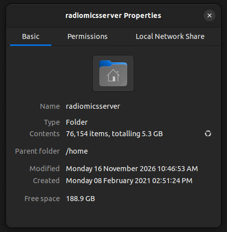

# Using the New Storage

Once the drives are mounted, nothing uses them automatically. You decide what goes where.

## The system drive does not overflow into the new drives

Each drive is a separate filesystem. If the system drive fills up, writes to it fail; Linux does not move files to the new drive. A full system drive can also break logins, package updates and Docker, so keep it from getting close to full.

The file manager's **Properties** dialog for your Home folder reports the free space of the **system drive**, because Home lives on it. It does not include the new drives:



The new drives are reached at `/mnt/data1` and `/mnt/data2` instead.

Check what is using space on the system drive:

```bash
df -h /
du -h --max-depth=1 ~ 2>/dev/null | sort -h | tail
```

## Option 1: save new work directly on the new drives

Point output folders (pipeline results, exports, model checkpoints, datasets) at `/mnt/data1` or `/mnt/data2`.

## Option 2: move large folders and link them back

```bash
rsync -avh --progress ~/BigFolder/ /mnt/data1/BigFolder/
# verify the copy is complete, then:
mv ~/BigFolder ~/BigFolder.old
ln -s /mnt/data1/BigFolder ~/BigFolder
```

Programs still find the data at the old path. Delete `BigFolder.old` only after you have confirmed everything works.

## Option 3: relocate Docker storage

Docker images and volumes are often the largest consumers of the system drive. Docker's data directory can be moved:

```bash
sudo systemctl stop docker docker.socket
sudo mkdir -p /mnt/data1/docker
sudo rsync -aH /var/lib/docker/ /mnt/data1/docker/
```

Edit `/etc/docker/daemon.json`:

```json
{
  "data-root": "/mnt/data1/docker"
}
```

```bash
sudo systemctl start docker
docker info | grep "Docker Root Dir"
```

After confirming containers and images work, you can remove the old `/var/lib/docker`. Snap-installed Docker uses a different location; check your installation method first.

## Option 4: combine drives into one large volume

LVM or `mergerfs` can present both drives as a single folder (about 7.2 TB). This is more involved, and with LVM the failure of one drive can affect data on both. It is usually better to keep the drives separate or use RAID 1.

## Parallel I/O

If a job reads from one drive and writes to another (for example reading images from `data1` and writing results to `data2`), the two drives can work in parallel, which can help throughput.

## Backups

The new drives make a convenient local backup target, but a second copy on the same machine does not protect against theft, fire, power surges or ransomware. Keep an independent copy of critical data elsewhere.
